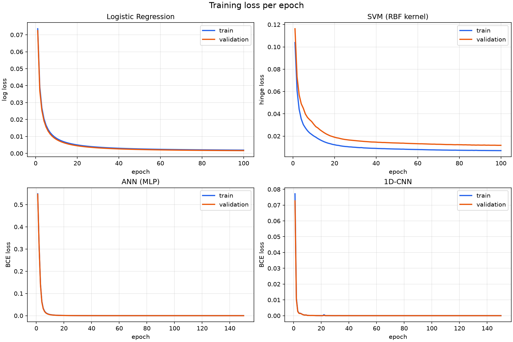
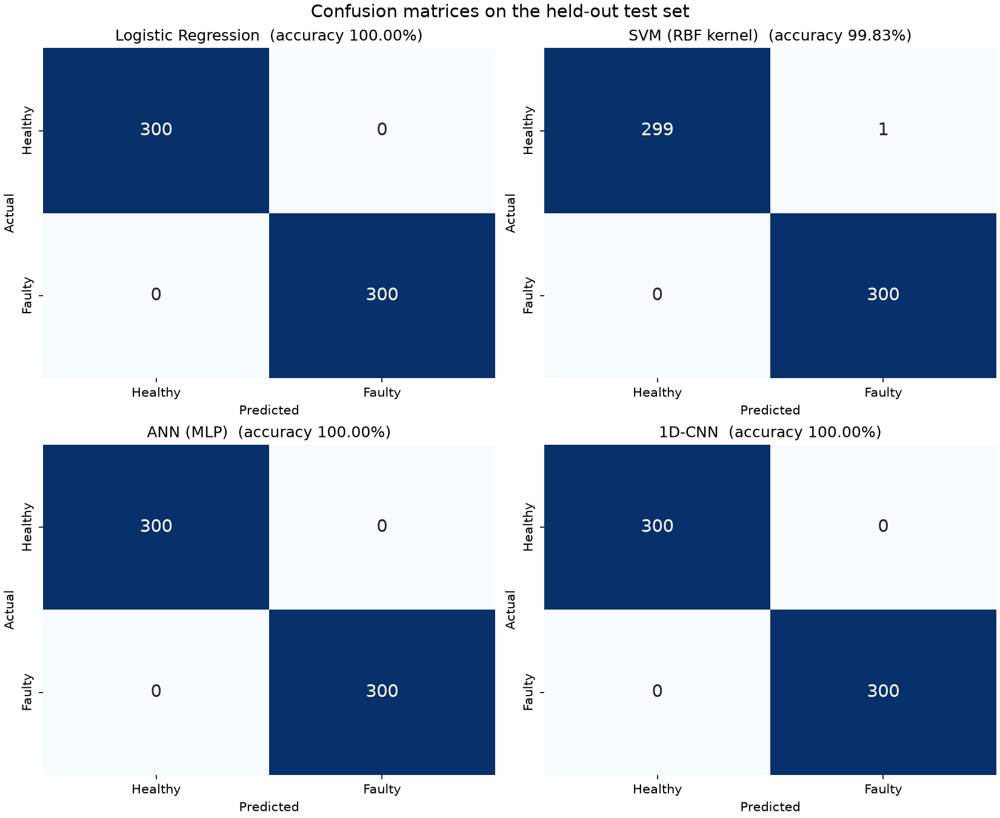

# BLDC Motor Fault Detection: Psychoacoustic Features

This project does binary classification of a BLDC motor as **Healthy** or **Faulty**, using only the four
**psychoacoustic features** in the CSV dataset. It trains and compares four models:

| # | Model | Implementation | Loss tracked per epoch |
|---|---|---|---|
| 1 | Logistic Regression | scikit-learn `SGDClassifier(loss="log_loss")` | log loss |
| 2 | SVM (RBF kernel) | scikit-learn `Nystroem` RBF features + `SGDClassifier(loss="hinge")` | hinge loss |
| 3 | ANN (MLP) | PyTorch | binary cross-entropy |
| 4 | 1D-CNN | PyTorch | binary cross-entropy |

For each model the project produces a **training/validation loss curve** and a **confusion matrix** on a held-out
test set.

---

## 1. Project layout

```
D:\ml
├── data/OpenSource/
│   ├── No Background noise/Psychoacoustic_Features/{Good_pure,Broken_pure}.csv
│   └── With Background noise/Psychoacoustic_Features/{Noisy_Good,Noisy_Broken}.csv
├── train.py                          # local script (uv run train.py)
├── bldc_fault_detection_colab.ipynb  # same pipeline as a notebook to upload to Google Colab
├── pyproject.toml / uv.lock          # dependencies, managed by uv
└── outputs/                          # generated: loss_curves.png, confusion_matrices.png, metrics.json
```

## 2. Dataset

| File | Condition | Label | Rows |
|---|---|---|---|
| `Good_pure.csv` | no background noise | 0 = Healthy | 1000 |
| `Broken_pure.csv` | no background noise | 1 = Faulty | 1000 |
| `Noisy_Good.csv` | with background noise | 0 = Healthy | 1000 |
| `Noisy_Broken.csv` | with background noise | 1 = Faulty | 1000 |

Each row is one analysis window of the motor's sound. The columns are:

* `Window`: a running index of the window. It is **not** used as a feature because it carries no information
  about motor health.
* **`Loudness`** (sone/phon scale): perceived sound level.
* **`Sharpness`** (acum): how much of the sound's energy sits at high frequencies.
* **`Fluctuation`** (vacil): slow amplitude modulation, around 4 Hz.
* **`Roughness`** (asper): fast amplitude modulation, around 70 Hz.

The label comes from the file name (`Broken` → Faulty, otherwise Healthy). Pure and noisy recordings are combined,
so the models have to work under both conditions.

Mean feature values per file:

| File | Loudness | Sharpness | Fluctuation | Roughness |
|---|---|---|---|---|
| Broken_pure | 38.74 | 2.111 | 1.97e-06 | 0.1071 |
| Good_pure | 37.84 | 1.643 | 4.48e-07 | 0.0621 |
| Noisy_Broken | 52.32 | 1.657 | 2.70e-06 | 0.0971 |
| Noisy_Good | 45.31 | 1.415 | 2.49e-06 | 0.0720 |

A faulty motor sounds **rougher** and **sharper** than a healthy one under the same noise condition. Roughness is
the clearest single separator.

## 3. Method

### Preprocessing
1. The 4 features are loaded into a `float32` matrix (4000 × 4).
2. The data is split **70 / 15 / 15** into train, validation and test sets (2800 / 600 / 600 samples). The split is
   stratified on *label × noise condition*, so every split contains all four recordings in equal proportion.
3. A **`StandardScaler`** is fitted on the training set only and then applied to all three sets. Scaling is
   essential here: `Fluctuation` is around 1e-6 while `Loudness` is around 40.

### Models
* **Logistic Regression.** scikit-learn's `LogisticRegression` and `SVC` do not report a per-iteration loss, so
  both linear-family models are trained with `SGDClassifier.partial_fit`, one epoch per call, and the loss is
  recorded after every epoch. With `loss="log_loss"` this *is* logistic regression, fitted by SGD
  (L2 α = 1e-4, constant learning rate 0.01, 100 epochs).
* **SVM (RBF kernel).** The RBF kernel is approximated with `Nystroem(gamma=0.5, n_components=300)`. A
  hinge-loss SGD classifier, which is a linear SVM, is then trained in that kernel feature space. The result is an
  approximate RBF-SVM that still gives a loss curve (100 epochs).
* **ANN.** An MLP: `4 → 32 → ReLU → Dropout(0.1) → 16 → ReLU → 1`.
* **1D-CNN.** The 4-feature vector is treated as a 1-channel signal of length 4:
  `Conv1d(1→16, k=3) → BN → ReLU → Conv1d(16→32, k=3) → BN → ReLU → Flatten → 32 → ReLU → Dropout(0.2) → 1`.
* **PyTorch training (ANN and 1D-CNN).** `BCEWithLogitsLoss`, Adam (lr 1e-3, weight decay 1e-5), batch size 64,
  150 epochs. The weights from the epoch with the **lowest validation loss** are restored before testing, which
  works like early stopping.

All random seeds are fixed at `42`, so runs are reproducible.

### Why no pretrained model?
No pretrained model fits this input. Each sample is just 4 numbers derived from one specific motor rig, while
public pretrained audio models (PANNs, AST, wav2vec 2.0, …) expect raw waveforms or spectrograms. There is
nothing to fine-tune, so the four models are trained from scratch. They are tiny and train in about a minute on a
CPU, so no GPU is needed. If you have the **raw audio**, a pretrained audio embedding model plus a small classifier
head would be a reasonable next step.

## 4. Results (held-out test set, 600 samples)

| Model | Accuracy | Precision | Recall | F1 | Confusion matrix `[[TN, FP], [FN, TP]]` |
|---|---|---|---|---|---|
| Logistic Regression | 1.0000 | 1.0000 | 1.0000 | 1.0000 | `[[300, 0], [0, 300]]` |
| SVM (RBF kernel) | 0.9983 | 0.9967 | 1.0000 | 0.9983 | `[[299, 1], [0, 300]]` |
| ANN (MLP) | 1.0000 | 1.0000 | 1.0000 | 1.0000 | `[[300, 0], [0, 300]]` |
| 1D-CNN | 1.0000 | 1.0000 | 1.0000 | 1.0000 | `[[300, 0], [0, 300]]` |

"Positive" means **Faulty**: recall is the share of faulty motors caught, and precision is the share of "faulty"
alarms that were correct.

### Loss curves


All four models converge within about 20 epochs, and the train and validation curves stay close together, so
there is **no overfitting**. The SVM's validation hinge loss sits slightly above its training loss, which is where
its single false alarm comes from.

### Confusion matrices


### Are these scores too good to be true?
Scores this high call for checks, so two extra experiments were run:

* **Leakage check.** Neighbouring windows from the same recording are very similar, so a random split could leak
  information between train and test. A *time-ordered* split was tested instead: windows 1–700 for training,
  701–1000 for testing. Logistic Regression and an exact `SVC` still scored **100%**. The high accuracy is real:
  in this dataset the classes are almost linearly separable, mainly by Roughness and Sharpness.
* **Cross-condition generalisation** (train on one noise condition, test on the other). This is much harder:

  | Train → Test | Logistic Regression | RBF-SVC |
  |---|---|---|
  | pure → noisy | 97.9% | 58.4% |
  | noisy → pure | 100% | 50.0% |

  The simple linear model transfers well. The RBF-SVM learns tight local boundaries that break when background
  noise shifts Loudness by about 10 units. Training on **both** conditions, as the main pipeline does, avoids the
  problem. For a real deployment you would want training data recorded in the target environment, and ideally
  from **more than one motor**: this dataset has one healthy and one faulty recording per condition, so the models
  may partly be learning to recognise those particular recordings.

## 5. Installation (uv)

Requires [uv](https://docs.astral.sh/uv/). Every step goes through uv: no pip and no manual virtualenvs.

```powershell
uv sync            # creates .venv and installs the locked dependencies (incl. dev tools ruff + ty)
```

Dependencies are listed in `pyproject.toml` and pinned in `uv.lock`: numpy, pandas, scikit-learn, torch,
matplotlib and seaborn. The dev group adds ruff and ty.

## 6. Usage

### Locally
```powershell
uv run train.py
```
This prints the dataset summary and per-model metrics, and writes `outputs/loss_curves.png`,
`outputs/confusion_matrices.png` and `outputs/metrics.json`.

### On Google Colab
1. Open <https://colab.research.google.com> → *File → Upload notebook* → `bldc_fault_detection_colab.ipynb`.
2. *Runtime → Run all*.
3. When the upload widget appears, select the four CSVs or a `.zip` of the `data/` folder.
4. The plots appear inline, and `outputs.zip` downloads at the end.

The notebook runs the same pipeline as `train.py`, plus a feature box-plot section. It works on CPU or GPU
runtimes.

## 7. Code quality: lint and type check

```powershell
uv run ruff check .            # lint train.py + the notebook (E,F,W,I,N,UP,B,SIM,NPY,PL,RUF rules)
uv run ruff format --check .
uv run ty check                                               # static type check of train.py
```

All three commands pass with no errors and no `# ty: ignore` / `# noqa` suppressions. The ruff and ty settings
are in `pyproject.toml`.

## 8. Code structure (`train.py`)

| Function / class | Purpose |
|---|---|
| `load_dataset` | Finds every CSV, adds the `label`, `noise` and `source` columns |
| `make_split` | Stratified 70/15/15 split and a scaler fitted on train only |
| `train_sgd` | Epoch-by-epoch `partial_fit` loop that records train/val loss |
| `run_logistic_regression`, `run_svm` | scikit-learn models |
| `ANN`, `CNN1D` | PyTorch model definitions |
| `train_torch` | Adam/BCE loop that keeps the best-validation weights |
| `run_ann`, `run_cnn` | PyTorch models |
| `compute_metrics`, `plot_losses`, `plot_confusion_matrices` | Reporting |
